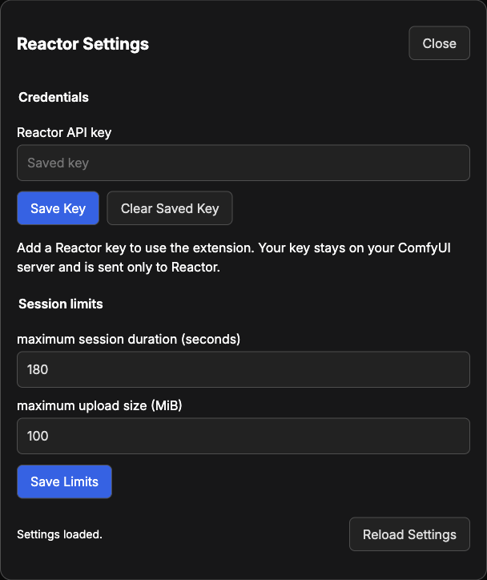

# ComfyUI Reactor Connector: Advanced Guide

Use this guide for settings, live controls, and recovery. For
installation and your first run, see [the setup guide](README.md). The native
**Info** of each node explains its inputs and model-specific limits.

## Contents

- [Keys and access](#keys-and-access)
- [Session limits](#session-limits)
- [Live controls](#live-controls)
- [Recording overhead](#recording-overhead)
- [Recovery](#recovery)
- [Update or remove](#update-or-remove)
- [Development commands](#development-commands)
- [Official packaging and publishing](#official-packaging-and-publishing)

## Keys and access

Add your key in **ComfyUI menu > Extensions > Reactor > Reactor settings**. It
stays on your ComfyUI server, and the connector sends it only to Reactor. The
connector never returns it to the window or writes it into a workflow.



`REACTOR_API_KEY` in the ComfyUI server environment takes precedence over a saved
key. Change it where you launch ComfyUI, then restart ComfyUI.

Private settings and live controls require a local, single-user connection.
Open the ComfyUI window on the computer running its server and connect directly
to the local address. Remote connections and reverse proxies cannot change
credentials. Set the server environment key for those setups.

The default state locations are:

| Platform | Directory                                         |
| -------- | ------------------------------------------------- |
| macOS    | `~/Library/Application Support/ReactorComfyUI`    |
| Linux    | `${XDG_STATE_HOME:-~/.local/state}/reactor-comfy` |
| Windows  | `%LOCALAPPDATA%\ReactorComfyUI`                   |

`REACTOR_COMFY_STATE_DIRECTORY` can select another absolute private path. It must
be outside the package, ComfyUI source, and configured input, output, temporary,
and user folders. Files use owner-only permissions where supported. They are
not encrypted; other code running as the same operating-system user can read them.

## Session limits

| Setting                                | What it limits                                                                  |
| -------------------------------------- | ------------------------------------------------------------------------------- |
| **maximum session duration (seconds)** | The whole Reactor session, setup included, so it must be longer than the video. |
| **maximum upload size (MiB)**          | Each image or video that the connector sends. One MiB is 1,048,576 bytes.       |

Reactor bills each session by the second, setup included. See Reactor's
[Pricing & Billing](https://docs.reactor.inc/resources/billing) for current rates.

A rejected command or uncertain connection is not retried automatically.

New runs use saved settings. A running session keeps its original key and limits.
Changing the effective key or execution limits prevents reuse of an earlier
ComfyUI result on the next run. Change **run number** to request a new run when
the other inputs stay the same. A seed does not guarantee identical results
after a provider update.

If another window saves settings first, reload before making your changes again.
Invalid settings leave the previous file intact. Saving settings does not cancel
active work or remove saved media.

## Live controls

Choose a recording duration before running. The live panel belongs to the
ComfyUI window that started the workflow. Leaving it open does not extend the
session. Find the examples in [Choose a workflow](README.md#choose-a-workflow).

Noninteractive generation can run through the ComfyUI API without a browser.
Interactive and webcam modes require the browser that submitted the workflow; a
bare API client cannot supply their controls. A browser is not required for the
local prompt-sequence and storyboard builders.

| Task                                     | Use                                                     |
| ---------------------------------------- | ------------------------------------------------------- |
| Change the scene while recording         | Helios, LongLive, or Visko live-prompt workflow         |
| Change an edit while a source clip plays | SANA or X2 live-prompt workflow                         |
| Drag an edited subject                   | X2 live-prompt or webcam workflow                       |
| Edit a camera feed                       | SANA or X2 webcam workflow                              |
| Move through an image                    | LingBot or LingBot World 2 workflow with scene controls |
| Continue several clips                   | Fast H3 continued-scene workflow                        |

Helios, LongLive, Visko, SANA, and X2 generation nodes have a **live controls**
switch, off by default. You cannot combine it with a Helios prompt sequence or
LongLive shots.

### Change prompts or use a webcam

1. Set the prompt and video length, then select **Run**.
2. On a webcam node, select **Enable Camera**, then allow camera access. Check
   the preview. To switch cameras, choose one, then select **Switch Camera**.
3. Select **Start Session** within 60 seconds.
4. When controls are ready, edit the prompt and select **Apply Prompt**.
5. Let the chosen recording duration finish to save the result.

Changes affect later frames and leave the saved workflow prompt unchanged.
LongLive uses a soft shot transition; Visko keeps **use prompt unchanged** as set
on the node. Starting and reference images stay fixed throughout the session.

Webcams need localhost or HTTPS, camera permission, and local single-user access.
The panel requests video only. Frames go to the local host before starting and
to Reactor only during the session. The connector takes no microphone input and
keeps no separate camera recording. Camera access stops when the panel closes or recording ends.

Input uses up to 640 × 480 pixels and ten new frames per second. The connector
repeats the latest frame on a 24 fps input. Saved output uses the model's resolution. The
separate preview uses up to 640 × 360 pixels at ten frames per second without sound.

### Change Visko audio

Turn **generate audio** on before running. During recording, edit **audio prompt**
and select **Apply Audio Prompt**. Leave it blank to let the picture guide sound.
Changes affect later sound; play the saved video to hear it. Resolution and sound
on/off stay fixed during the session. Changing them requires a new run.

### Drag in X2

Drag on the output to steer the subject; release to stop. For keyboard control,
focus the picture, use arrow keys to position the pointer, and hold Space to
activate it. Escape or losing focus releases the pointer. A circle marks your
chosen point, measured from the picture's left and top edges.

**Pointer held** and **Pointer released** confirm that Reactor accepted the input. Watch
later frames to judge its effect. X2 processes groups of frames, so changes can lag.

### Move in LingBot

Upload an image and run a workflow with scene controls. Click the picture: W and
S move forward and back, A and D move sideways, and arrow keys turn. Click a direction
button briefly or hold it to keep moving. Escape releases movement. World 2 can
combine forward and sideways movement.

Rapid changes can skip earlier movements; the panel releases old movement before
it applies the latest direction. Edit **scene prompt** and select **Apply Prompt**
to change later frames. Editing the prompt releases held movement. The starting
image and saved workflow prompt stay unchanged. Saved video cannot reopen a world,
and clicking its playback does not move the camera.

### Save or stop

Let recording finish. **Save Video** writes the result under ComfyUI's
output folder. **End Session** stops early and discards the unfinished video.
ComfyUI cancellation also ends the run. Closing a workflow tab does not cancel it.

The session ends if the live panel stops responding for five seconds. Webcam input
also ends after three seconds without a new frame. Cleanup can take longer; wait for
the end message. The connector does not reconnect automatically.

### Continue a scene

[Fast H3 continued scenes](web/docs/ReactorIncFastContinue.md) use the previous
clip's final frame to build the next clip. Choose a clip count and later prompts.
The result is one video with sound. Recording ends after the chosen number of
clips; their combined length must be 60 seconds or less.

## Recording overhead

### Fast H3

After the selected clip finishes, the connector builds and starts one additional
continuation. This advances the recording service so it can finish the selected
clip's media fragments. The continuation uses credits, but the saved output
leaves it out. Its requested length is the deployment's longest clip, currently
14.375 seconds. The session ends as soon as the selected recording is ready,
even if that continuation has not finished. The host session cap still applies.

### LTX

LTX may generate up to 20 extra seconds while Reactor prepares the recording.
These seconds can use credits and are not saved. The session time limit applies
to the whole run.

## Recovery

Read the error and the native **Info** of the node before trying again. When Reactor
refuses a run, the error ends with **Reactor said:** and Reactor's own reason.
A failed run returns no video. The connector does not retry a rejected command
or a lost connection.

Use ComfyUI's cancel control to stop a queued or running workflow. Closing the
browser or a workflow tab does not cancel a run without live controls, and
pausing a video preview does not stop its session. With live controls on,
closing the live panel or losing its browser connection ends the session and
discards the unfinished video.

Unchanged inputs can reuse ComfyUI's cached video. Change **run number** to run
again. A new key or new limits in Reactor settings also start a new run. A seed
does not guarantee the same result after Reactor updates a model.

| Problem                      | Next step                                                                                        |
| ---------------------------- | ------------------------------------------------------------------------------------------------ |
| Missing or rejected key      | Check Reactor settings and any server environment key, which takes precedence.                   |
| Rejected input               | Check the node's prompt, image, video, duration, and size limits.                                |
| Video did not arrive in time | Check [Reactor status](https://status.reactor.inc/) and the session limit before retrying.       |
| Recording cannot be saved    | Check disk space and media limits. Some models also need Reactor's recording service.            |
| A live panel expires         | Let cleanup finish before running again.                                                         |
| Camera is unavailable        | Allow access, select **Enable Camera**, and release the camera in another application if needed. |

## Update or remove

Finish or cancel active work, wait for sessions to end, then stop ComfyUI
before changing the connector.

To update a source checkout, replace the whole `custom_nodes/reactor-inc` folder
with the new source, install its runtime requirements using ComfyUI's Python,
and restart. Refresh the
ComfyUI window.

Keep only one installed copy in `custom_nodes` to avoid duplicate nodes and menus.

Open an updated example in a new workflow tab. Existing tabs and saved graphs
keep their own notes, prompts, and layout. Copy settings you want to reuse before
closing the old graph.

To remove the connector, move its folder outside `custom_nodes` and restart.
Keep shared Python dependencies that other packs may use. Removing or updating
the package preserves private state, media, and saved workflows. To remove state
too, first confirm that all sessions ended. Then delete only its
[state directory](#keys-and-access).
Deleting a saved key does not revoke it in Reactor.

## Development commands

Name your ComfyUI installation before setup, in an ignored `.mise.local.toml`.
`COMFYUI_PATH` is the folder that contains `main.py` and `comfy_api`, and
`COMFYUI_PYTHON` is the Python executable of that installation:

```toml
[env]
COMFYUI_PATH = "/path/to/ComfyUI"
COMFYUI_PYTHON = "/path/to/ComfyUI/.venv/bin/python"
```

Replace these example paths with the paths of your installation. For Windows
portable, `COMFYUI_PYTHON` is the embedded Python executable.

Run `mise run setup` once in the checkout. It installs the pinned tools, runs
`mise run deps`, and runs `gspot install`, which installs the check tools and
turns on the Git hooks. `mise run deps` installs the locked development
dependencies and puts that ComfyUI installation on the path of the project
environment. The type checker and the workflow build then read the actual
ComfyUI types and node schemas.

Bun manages frontend dependencies; uv manages Python dependencies. Development
tools use the repository environment, separate from ComfyUI. Development scripts
run as modules of the checkout package through mise. ComfyUI starts media workers
through the root launcher in isolated Python processes; those workers use only
the media modules and static configuration.

Browser TypeScript and CSS in `web/scripts/` build to `web/extension.js` and
`web/extension.css`. ComfyUI serves node guides from `web/docs/`. Frontend checks
use the official ComfyUI frontend types.

### Checks and hooks

gspot runs the repository checks. Its settings are in `gspot.toml`, and it writes
the tool configuration files from them. Run each command from the repository
root:

| Command                                           | Purpose                                               |
| ------------------------------------------------- | ----------------------------------------------------- |
| `bun run --no-install gspot check`                | Run the commit and push checks on the working tree.   |
| `bun run --no-install gspot check --fix`          | Run the formatters and other fixers, then the checks. |
| `bun run --no-install gspot check --only <check>` | Run one check, such as `comfy-workflows`.             |

The Git hooks run the same checks. Pre-commit runs `gspot check --hook
pre-commit` on the staged files, commit-msg checks the commit message, and
pre-push checks the pushed commits. The hooks check a copy, so they do not stash
or rewrite your work.

gspot also runs the checks of this repository. `comfy-boundary` keeps the
imports of ComfyUI modules at the ComfyUI boundary. `comfy-requirements`,
`comfy-frontend`, `comfy-nodes`, and `comfy-workflows` each run the check task
of the same name in the next table, such as `mise run comfy:nodes:check`.

### Tasks

The `comfy` tasks build, check, and release the connector. Run `mise tasks` to
list every task.

| Command                             | Purpose                                                                               |
| ----------------------------------- | ------------------------------------------------------------------------------------- |
| `mise run setup`                    | Install tools and dependencies, then turn on the Git hooks.                           |
| `mise run deps`                     | Install locked development dependencies and add the ComfyUI installation to the path. |
| `mise run comfy:frontend:build`     | Build the shipped JavaScript and CSS with `bun run build`.                            |
| `mise run comfy:frontend:check`     | Check that the shipped JavaScript and CSS match a fresh build.                        |
| `mise run comfy:workflows:build`    | Build the example graphs and workflow index.                                          |
| `mise run comfy:workflows:check`    | Check that the example graphs match a fresh build.                                    |
| `mise run comfy:nodes:check`        | Check node registrations and guides.                                                  |
| `mise run comfy:requirements:build` | Write `requirements.txt` from the runtime dependencies in `pyproject.toml`.           |
| `mise run comfy:requirements:check` | Check that `requirements.txt` matches `pyproject.toml`.                               |
| `mise run comfy:release:package`    | Run checks, then build the official node.zip with comfy-cli and inspect it locally.   |
| `mise run comfy:release:publish`    | Check and package the connector, then publish a Registry version with comfy-cli.      |

Builds write generated assets; checks and hooks do not install dependencies or
start generation.

The workflow builder writes flat JSON files under `example_workflows/`, the
directory ComfyUI's native Templates browser reads. The same files appear in
native **Browse Templates > reactor-inc** from a checkout and from an installed
package. Rebuild examples before packaging.

Python checks use actual ComfyUI and dependency types. Where an upstream API lacks
complete annotations, the code defines only the interface it consumes. Check
changed host calls manually in the installed ComfyUI as well.

### Images

The README's and this guide's images are in `docs/images/`:

- `banner.svg`, `node-map.svg`, and the four badges in `badges/` are SVG files;
  edit them as text.
- The SVG files use the colors of Reactor: black `#070809`, surfaces `#111214`,
  hairlines `#272727`, cream `#F2EEDC`, muted `#8F8A7C`, and the gold gradient
  `#ECE5BD` to `#C7C099`.
- Headings use Helvetica Neue with tight spacing; labels use a monospace font in
  wide-spaced capitals. Keep shapes square-cornered or rounded rectangles, like
  the film frame in the logo.
- `logo.png` is the mark of the connector: a capital R whose bowl is a film frame
  and whose leg is a plug. OpenRouter's `openai/gpt-image-2.5-sunburst` drew it on
  a transparent background, and the file is a 400 × 400 pixel crop.
- The banner embeds the logo on a film strip, and `pyproject.toml` names the logo
  as the Registry icon.
- The node map has one card per model. A gold square marks a node that opens a
  Reactor session and a hollow square one that runs locally. A gold arrow runs
  from an output to the input it feeds.
- The badges under the banner name the ComfyUI, frontend, and Python versions
  and the license, as black pills with a gold value; update them when those
  change.
- `workflow-prompt-sequence.png` is helios-03-prompt-sequence at 100% zoom, with
  link midpoint markers off.
- `fast-h3-node.png` is a new **Fast H3: Generate Video** node, 420 pixels wide,
  at 100% zoom.
- `settings-dialog.png` is the **Reactor settings** dialog with default settings
  and a saved key.

Keep each image under 100 KB, and give it alt text.

## Official packaging and publishing

Use [Comfy's official CLI](https://github.com/Comfy-Org/comfy-cli) to create and
publish the Registry package. The commands below use comfy-cli 1.20.0.

1. Create a publisher and publishing API key in
   [Comfy Registry](https://docs.comfy.org/registry/publishing). The publishing
   key is separate from the Reactor key that generates videos.
2. Set `[tool.comfy].PublisherId` to that publisher's ID in `pyproject.toml`.
   Check `[project.urls].Repository` and choose an unused semantic version in
   `[project].version`. Published versions cannot be overwritten.
3. Build the distribution files:

    ```sh
    mise run comfy:requirements:build
    mise run comfy:workflows:build
    mise run comfy:frontend:build
    ```

4. Commit the reviewed source and built assets. The official packer selects
   Git-tracked paths and reads their current working-tree content. It leaves out
   new untracked files. `.comfyignore` excludes development files.
5. Run the release task:

    ```sh
    mise run comfy:release:package
    ```

    This runs the commit and push checks with `bun run --no-install gspot check`.
    It then calls `comfy node pack`, lists the contents of `node.zip`, and scans the
    archive for secrets with gitleaks.

6. Publish when ready. This repeats the package checks before publishing:

    ```sh
    mise run comfy:release:publish
    ```

    Enter the Registry publishing key at the hidden prompt. No `.env` file is
    required. This CLI does not read `REGISTRY_ACCESS_TOKEN` automatically.

    Choose the publisher ID yourself when creating the account. Comfy requires
    this public ID in the committed `pyproject.toml`; you cannot rename it after
    you create the account. The API key authorizes publishing and stays private.

7. Install the published version through ComfyUI Manager and check node loading,
   menus, help, and templates in that installation.

Publishing creates a new archive from the checkout. Keep the source, built
assets, tracked paths, metadata, `.comfyignore`, and CLI version unchanged after
inspection. The publish command does not upload the `node.zip` that you
inspected.

For a later release, update the version, then repeat this procedure. Keep publishing
credentials outside the repository and browser assets.
